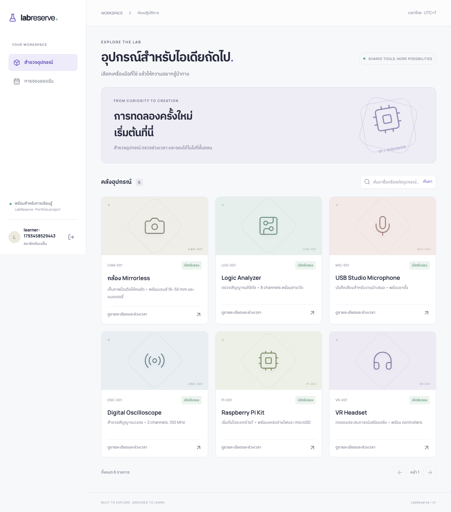

# LabReserve

ระบบจองอุปกรณ์ห้องแล็บ พร้อมเส้นทางเรียน Software Development ภาษาไทยจากศูนย์



**เริ่มเรียน:** [บท 00 — ทดลองระบบและติดตามหนึ่งคำขอ](docs/lessons/00.md) · [สารบัญบทเรียน](docs/lessons/README.md)

## ระบบนี้ทำอะไร

สมาชิกสมัคร เข้าสู่ระบบ ค้นหาอุปกรณ์ ตรวจช่วงเวลา จอง และยกเลิกได้ ผู้ดูแลเพิ่ม/แก้ไขอุปกรณ์ ปิดรับจอง และยกเลิกรายการพร้อมเหตุผล ทุกการจองมีประวัติที่บันทึกพร้อมสถานะใน transaction เดียว

จุดที่ควรอ่านใน portfolio: PostgreSQL exclusion constraint ป้องกันช่วงจองซ้อน แม้มีคำขอพร้อมกัน, server-side authorization, hashed sessions, CSRF, tests กับ PostgreSQL จริง และการซ้อม restore

นี่เป็นระบบอ้างอิงเพื่อเรียนรู้ที่ AI ช่วยสร้างตาม requirement ของเจ้าของโปรเจกต์ ยังไม่มีหลักฐานการดูแล production สาธารณะ ดู [ข้อจำกัดและผลตรวจจริง](docs/verification.md) และ [แนวทางนำไปใช้ใน portfolio](docs/portfolio.md)

## เผยแพร่ออนไลน์ฟรี

ใช้ [คู่มือ Render Free + Neon Free](docs/deploy-free.md) และ `render.yaml` ที่รากโปรเจกต์ โดยใช้ Docker image เดิม มี HTTPS และ migration ก่อนเริ่ม server ยังต้องเชื่อมบัญชีและตรวจเว็บจริงก่อนมีลิงก์สาธารณะ

## เปิด demo ด้วย Docker (เริ่มตรงนี้)

ต้องมี Docker Desktop ที่เปิดอยู่ และ Git หากจะ clone โปรเจกต์ คำสั่งทั้งหมดรันจากโฟลเดอร์รากที่มี `package.json` และ `compose.yaml`

```bash
docker compose up -d --build
docker compose exec -e ALLOW_DEMO_SEED=1 app node apps/api/dist/apps/api/scripts/seed.js
docker compose ps
```

เปิด [http://localhost:3000](http://localhost:3000) รอให้ app และ db มีสถานะ healthy

| บัญชี local demo | อีเมล                  | รหัสผ่าน        |
| ---------------- | ---------------------- | --------------- |
| สมาชิก           | member@labreserve.test | Local-demo-123! |
| ผู้ดูแล          | admin@labreserve.test  | Local-demo-123! |

บัญชีเหล่านี้เป็นข้อมูลสาธารณะสำหรับ local demo เท่านั้น Compose ผูกพอร์ตกับ localhost และใช้ development mode อย่านำค่าเหล่านี้ไปเปิดสาธารณะ

```bash
docker compose logs --tail=30 app
docker compose stop
docker compose start
```

`stop` เก็บข้อมูลไว้ใน volume; ไม่ต้องลบ volume เพื่อเริ่มใหม่ หากพอร์ตฐานข้อมูล 55432 ถูกใช้อยู่ ตั้ง `POSTGRES_PORT=55433` ใน `.env` หรือก่อนคำสั่ง Compose หากเปลี่ยน APP_PORT ต้องตั้ง COMPOSE_APP_ORIGIN ให้ตรงกันด้วย

## รันเพื่อแก้โค้ด

ต้องมี Node.js 24 LTS และ npm เพิ่มจาก Docker ใช้เพียงฐานข้อมูลใน Docker และรัน API/React บนเครื่อง หากเปิด Compose app อยู่ให้หยุดเฉพาะ app ก่อนเพื่อคืนพอร์ต 3000

```bash
docker compose stop app
docker compose up -d db
cp .env.example .env
npm ci
npm run db:migrate
ALLOW_DEMO_SEED=1 npm run db:seed
npm run dev
```

เปิด [http://localhost:5173](http://localhost:5173) — Vite ส่ง `/api` ต่อไป Express ที่พอร์ต 3000 หากเคยเลือกพอร์ตฐานข้อมูลอื่น ให้แก้ DATABASE_URL ใน `.env` ให้ตรงกันก่อน migrate

## ตรวจงาน

```bash
npm run check
npm run format:check
npm test
npm run build
```

Integration tests ใช้ฐานข้อมูลแยกชื่อท้าย `_test` และล้างข้อมูลในฐานนั้นทุก test ห้ามชี้ TEST_DATABASE_URL ไปยังข้อมูลที่ต้องเก็บ

```bash
docker compose exec db createdb -U labreserve labreserve_test
docker compose exec db createdb -U labreserve labreserve_e2e_test
npm run test:integration
npx playwright install chromium
npm run test:e2e
```

`createdb` ทำครั้งแรกเท่านั้น หากฐานมีอยู่แล้วข้ามได้ ค่าเริ่มต้น tests ใช้พอร์ต 55432; หากเปลี่ยนพอร์ตต้องส่ง TEST_DATABASE_URL และ E2E_DATABASE_URL ให้ตรงกัน Tests ไม่โหลด `.env` โดยอัตโนมัติ Browser tests ใช้พอร์ต 3100 และ reset เฉพาะฐานท้าย `_e2e_test` ก่อน seed ทุกครั้ง

## แผนที่โค้ด

```text
apps/api/src/              Express, sessions, equipment, reservations
apps/api/migrations/       PostgreSQL schema และ constraints
apps/api/test/             กติกาและ API integration tests
apps/web/src/              React UI, API client, การแปลงเวลาไทย
packages/contracts/src/    schemas และ DTO ที่ใช้ร่วมกัน
e2e/                      browser tests
examples/                 CLI และ race-condition lab แยกจากแอป
scripts/                  load test, restore drill, browser fixtures
docs/lessons/              13 บทเรียนภาษาไทย
docs/solutions/            เฉลย แยกจากบทเรียน
```

## อ่านต่อ

- [สถาปัตยกรรมและ ER diagram](docs/architecture.md)
- [เหตุผลการตัดสินใจ](docs/adr/README.md)
- [API contract](docs/openapi.json) — OpenAPI 3.1 เปิดด้วย OpenAPI viewer ได้
- [Deployment, rollback และ recovery](docs/operations.md)
- [ผลการตรวจและข้อจำกัด](docs/verification.md)

ก่อนนำไป production ต้องเลือก hosting/TLS/secrets, ทบทวน email verification/account recovery, abuse protection, privacy/retention และ backup ตามบริบท ระบบนี้ยังไม่ได้ deploy ไปบริการภายนอก
