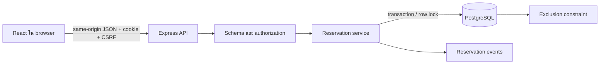
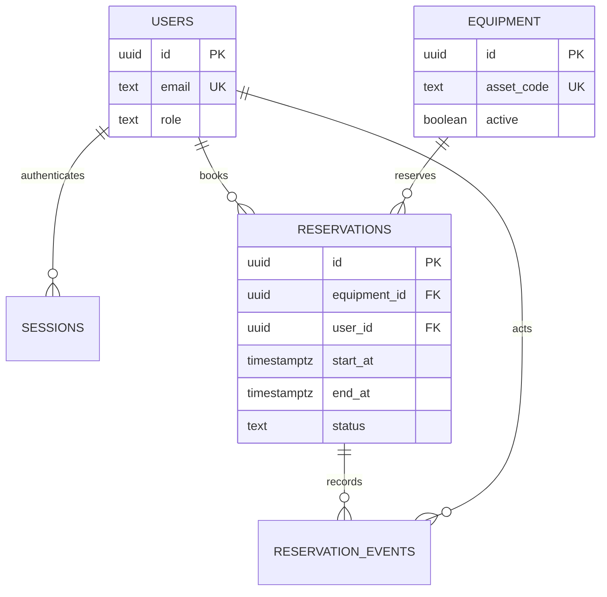

# สถาปัตยกรรม LabReserve

## อ่านหนึ่งคำขอก่อนอ่านทั้งระบบ

เมื่อกดจอง: `EquipmentDetail` แปลงเวลาที่กรอกเป็น ISO ที่มี offset → `api()` ใส่ CSRF token → Express ตรวจ session → Zod ตรวจ input → service เริ่ม transaction และ lock อุปกรณ์ → PostgreSQL ตรวจช่วงซ้อน → บันทึก event → commit → หน้ารายละเอียดแสดงผล

Production build เสิร์ฟ React ผ่าน Express origin เดียว ลดการตั้งค่า cross-origin ส่วน development ใช้ Vite proxy ระบบไม่แชร์ state ใน memory ยกเว้น rate limiter ซึ่งเป็นเหตุผลให้ขอบเขต deployment เริ่มที่ instance เดียว

## กติกาที่เป็น invariant

1. อุปกรณ์ชิ้นเดียวมี confirmed reservations ที่ช่วงเวลาซ้อนกันไม่ได้ แม้เขียนตรงฐานข้อมูล
2. ช่วงเป็น `[start,end)` จึงจอง 10:00–11:00 และ 11:00–12:00 ต่อกันได้
3. สถานะและ event commit หรือ rollback พร้อมกัน
4. สมาชิกอ่าน/ยกเลิกเฉพาะของตน ผู้ดูแลเห็นทั้งหมดเมื่อเลือก scope=all
5. ปิดรับจองไม่ลบของเดิม; booking และ equipment update ใช้ lock แถวเดียวกัน

มีเพียง confirmed/cancelled ที่ persist ส่วน phase คำนวณด้วยเวลาของฐานข้อมูล จึงไม่ต้องมี cron เปลี่ยน active/completed ทุกนาที Deadline cancellation ตรวจที่ server โดยใช้เวลาจริงขณะทำงาน

## ความปลอดภัยที่ตรวจได้

- Password ใช้ Argon2id; session เป็น random token โดยเก็บ SHA-256 digest ในฐานข้อมูล
- cookie HttpOnly, SameSite=Strict, Secure ใน production; `__Host-` prefix เมื่อ secure
- CSRF token ที่ลงนาม HMAC อยู่ใน cookie HttpOnly และส่งค่าที่ตรงกันใน custom header; ตรวจ Origin เพิ่มทุก mutation
- Login หมุน session และลบอันเดิม, logout ลบจากฐานข้อมูล, expiry 8 ชั่วโมง
- HTTP DTO ไม่ส่ง password hash/session data; log ไม่บันทึก body, cookie หรือ query string
- Parameterized SQL; Zod ตรวจ runtime input; จำกัด body 16 KB และ pageSize ≤ 50

CSRF token ไม่ใช่รหัสผ่าน และไม่ได้ช่วยป้องกัน XSS ทุกกรณี ใช้ร่วมกับ React escaping และ Helmet headers หลักฐานทดสอบอยู่ใน `apps/api/test/api.integration.test.ts` ไม่ใช่การรับรองผ่านมาตรฐานความปลอดภัยทั้งหมด

## ไฟล์ที่ควรไล่อ่าน

| ความรับผิดชอบ                  | ไฟล์จากรากโปรเจกต์                      |
| ------------------------------ | --------------------------------------- |
| HTTP middleware/error boundary | apps/api/src/app.ts                     |
| กติกาเวลาแบบ pure function     | apps/api/src/reservations/rules.ts      |
| transaction ของ use case       | apps/api/src/reservations/service.ts    |
| read model และประวัติ          | apps/api/src/reservations/repository.ts |
| database invariant             | apps/api/migrations/001_initial.sql     |
| UI booking                     | apps/web/src/pages/Equipment.tsx        |
| HTTP client                    | apps/web/src/api.ts                     |

Equipment CRUD ใช้ SQL ใกล้ routes เพราะ query ตรงไปตรงมา ส่วน reservation แยก service/repository เนื่องจากมี transaction และกติกาหลายขั้น แยกชั้นเมื่อช่วยให้อ่านและทดสอบง่ายขึ้น ไม่ใช่เพิ่มไฟล์ให้ทุก endpoint เท่ากัน
